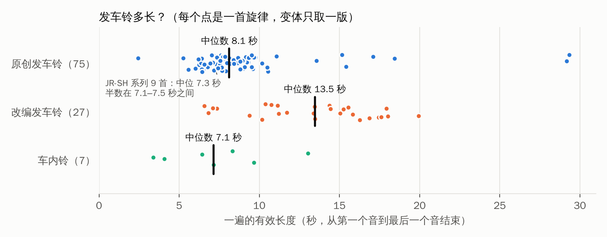
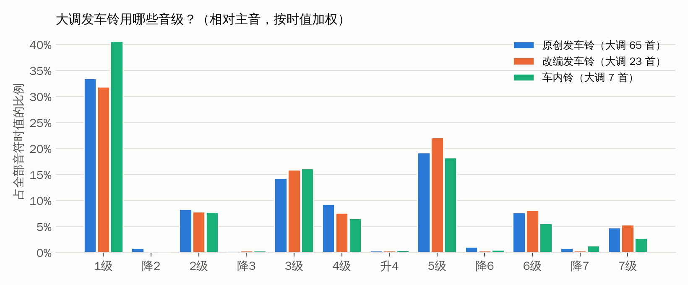

# 发车铃分析与创作指南

本文分析了仓库里的两批材料：
- **181 首发车铃**：MP3，加上 `harmonica_midi/` 里的自动转写 MIDI。
- **根目录的 11 个手工 MIDI**：3 首发车铃、7 首车内铃、1 首用途不明。

从风格、音阶、和声、旋律、织体、节奏和编曲技法几方面总结规律，最后整理成「如何写出一段好的发车铃」的方法和检查清单。按这些方法写的 6 个实践 MIDI 见 [`compositions/`](../compositions/README.md)。

分析脚本和全部数据在 [`analysis/`](../analysis/README.md)。

网页版在 [`web/index.html`](../web/index.html)，带交互图表和在线试听。把整个仓库下载下来，用浏览器打开即可，说明见 [`web/README.md`](../web/README.md)。

---

## 0. 先回答：分析时要不要分类？

**要，而且要分两层**：

| 分类 | 为什么要分 | 数据上的差别 |
|---|---|---|
| **用途：发车铃 vs 车内铃** | 发车铃在站台反复播放，可能被按钮随时切断，也可能循环。车内铃在列车广播前响一次。前者要能循环、能被打断，后者要一次说完、明确收尾。 | 手工车内铃 7 首，旋律和和声全部收在主音/主和弦。发车铃的旋律只有 41–52% 落在主音，JR-SH 系列只有 22%。 |
| **来源：原创 vs 改编** | 原创要解决的是「写什么」。改编要解决的是「截哪一段、怎么塞进十几秒、怎么换成铃声音色」。旋律和和声是原曲给定的，不能拿来说明作者的取舍。 | 改编的中位长度 13.5 秒，原创 8.1 秒。改编旋律的中位音高 D5，原创 A5。改编七和弦用得更多。 |

另外还有一层**「同曲多版本」**。181 个文件只有 113 个不同的旋律，其余 68 个是同一旋律的移调、变速、截段等版本，例如 Water Crown 有 10 个。统计时每个「旋律族」只取一个版本，避免被重复版本带偏。变体本身单独作为一种技法来分析（见 3.8）。

### 分类结果

| 类别 | 旋律族 | 文件 | 说明 |
|---|---|---|---|
| 原创·JR-SH 系列 | 9 | 26 | JR 东日本较早期的发车铃系列，有 -1、-2、高音/低音等版本 |
| 原创·SF 系列 | 13 | 14 | JR 东日本编号曲，如 SF-1「遊園地のある駅」（大崎）、SF-3「教会の見える駅」（秋叶原） |
| 原创·东洋媒体链接（東洋メディアリンクス）西班牙语标题系列 | 4 | 24 | Water Crown、Cielo Estrellado、Gota del Vient、Verde Rayo，版本最多 |
| 原创·英文标题系列（出处未确认） | 16 | 18 | airy、cappuccino、mellow time、sunny islands 等 |
| 原创·日文标题曲库（出处未确认） | 33 | 45 | 海岸通り、九月の風、高原等，多有 V1/V2 两版 |
| 改编 | 27 | 40 | 昭和歌谣 8、古典器乐 4、市歌 3、迪士尼 2、广告歌 2、流行歌 2、体育应援 2、唱歌/童谣 2、民谣 1、外国流行歌 1 |
| 不确定 | 11 | 14 | 如 HANDS、Keep On Rising、Vamos Ardija；不参与原创和改编的对比 |
| 车内铃（手工 MIDI） | 7 | 7 | 189系、373系、キハ85、こだま、のぞみ（原创）；鉄道唱歌、ハイケンスのセレナーデ（改编） |

分类主要依据曲名，加上能查证的系列信息。逐首的分类和可信度见 [`analysis/catalog.csv`](../analysis/catalog.csv)。

---

## 1. 数据可信度

- **自动转写**：181 首 MIDI 的音符约 3/4 正确，常见错误是八度错和多出来的泛音。
  - 下面的数字里，调、速度、长度、音级分布、和弦大框架、最后的和弦比较可靠。和 farewell、SF22-29 的手工 MIDI 对照，这些都一致。
  - 旋律音程（级进/跳进的比例）在自动转写里不可靠，最高声部会混进伴奏。所以第 3.4 节的音程数字只用手工 MIDI 的旋律声部。
- **调的识别**：会把关系大小调弄混。按 MIDI 和按音频识别，181 首里 69% 一致。
- **案例**：第 4 节的具体旋律和和声都来自手工 MIDI，是逐音读出来的。

---

## 2. 总体画像

下表每格是中位数，括号里是中间一半作品所在的范围。

| 指标 | 原创发车铃 | 改编发车铃 | 车内铃（手工） |
|---|---|---|---|
| 旋律族数 | 75 | 27 | 7 |
| 一遍的长度 | **8.1 秒**（7.2–9.3） | **13.5 秒**（10.6–16.1） | 7.1 秒（5.2–9.0） |
| 10 秒以内的比例 | 85% | 19% | — |
| 速度（BPM，约） | 120（105–128） | 121（106–130） | — |
| 旋律每秒音数 | 3.3 | 3.3 | 2.3 |
| 大调比例 | **87%** | 85% | 100% |
| 主音 1 级占全部音符时值 | 33% | 31% | 41% |
| 五声音级（1 2 3 5 6）占比 | 82% | 84% | 92% |
| 4、7 级占比 | 13% | 13% | 8% |
| 旋律中位音高 | **A5**（MIDI 81，约 880 Hz） | D5（MIDI 74） | A♯5 |
| 旋律中位音高在 C5 以上 | 91% | 78% | — |
| 低于 C3 的音 | 几乎没有 | 几乎没有 | 没有 |
| 平均同时发声数 | 2.8 | 2.7 | 2.2 |
| 最后的和弦是 I | 63% | 70% | 100%（人工核对） |
| 旋律最后一音是主音 | 41% | 52% | 100%（人工核对） |

**一句话概括**：
- 原创发车铃是一段约 8 秒、约 120 BPM 的大调小曲。
- 旋律在 C5–E6 的明亮音区，围着主和弦的 1、3、5 转，五声音级为主。
- 和声简单，常带 sus4 和 add9 的「钟声」色彩，几乎不用重低音。

---

## 3. 分维度分析

### 3.1 风格：不同系列各有一套「口音」

| 系列 | 长度 | 调式 | 织体 | 结尾 | 听感 |
|---|---|---|---|---|---|
| JR-SH | **7.3 秒，非常统一**（一半在 7.1–7.5 秒） | 大调 6/9，小调 3/9，调外音最多（15%） | 和弦式起音占 89%，是「一下一下的和弦铃」 | 只有 2/9 落在 I，像为循环设计 | 早期合成器钟声，色彩偏浓 |
| SF | 8.1 秒 | 大调 12/13 | 旋律加分解和弦 | **85% 落在 I** | 明快、规整，I–IV–V 清楚 |
| 西班牙语标题（Water Crown 等） | 11.4 秒，最长 | **4 首里 3 首偏小调/调式色彩**，♭3、♭6、♭7 用得多 | 线条式，和弦式起音只占 30%，琶音流动 | 多停在 ♭VII、♭VI 等 | 有「流动感」，最常被移调、变速做成多版本 |
| 英文标题 | 8.1 秒 | **100% 大调** | 较稀疏，旋律每秒 2.7 个音，最慢 | 81% 落在 I | 轻柔、留白多（airy、mellow time） |
| 日文标题曲库 | 8.4 秒 | 大调 91% | 中等 | 61% 落在 I | 风景画式的标题，常有 V1/V2 两个版本 |
| 改编 | 13.5 秒 | 大调 85% | 和弦式起音约 70% | 70% 落在 I | 保留原曲辨识度，音区更低 |

### 3.2 音阶：主音中心，五声骨架，4、7 级当润滑

- **大调占绝对多数**：原创 87%、改编 85%。
  - 原创里的 10 首小调，JR-SH 占 3 首，西班牙语标题系列占 3 首（Water Crown、Gota del Vient、Verde Rayo）。小调和调式色彩是少数系列用来做出「个性」的手段。
- **主音和主和弦压倒性**：1 级一个音就占全部音符时值的 1/3。1、3、5 三个音合计约 2/3（见上面的音级图）。铃声的本质就是反复敲响主和弦。
- **五声音级为骨架**：1 2 3 5 6 占 82%（车内铃 92%）。
  - 4、7 级只占约 13%，主要当经过音、导音，或在 V7、IV 和弦里出现。
  - **严格五声**（4、7 级合计不到 5%）的原创有 9 首：JR-SH4、SF10-60「チャイム」、blue daisy、Cielo Estrellado、dance on、mellow time、mint flavor、あざみ野 V1、高原のつぶやき。改编有 3 首：汽車、アマリリス、オー・シャンゼリゼ。
- **半音几乎只用作「点睛」的邻音**，调外音中位数是 0。手工 MIDI 里的例子：
  - のぞみ：`E–E♭–E`、`B–B♭–B`
  - farewell：`A–A♭–D`
  - 189系：同一动机第二次出现时把 F 改成 F♯

### 3.3 和声：短、稳、带一点色彩

- **I 占主导**：约 45% 的拍子停在主和弦上。其次是 V（11%）、IV（8%）、vi（5%）、ii（4%）。
- **换和弦的节奏**：每个和弦约 2.5 拍，也就是每半小节到一小节换一次。
- **色彩和弦**：约 1/5 的拍子是 sus4 或 add9，开放、不解决的钟声感。七和弦在原创里用得很少（中位数 0），改编里多一些（中位数 8%）。
- **流行歌常用的长套路一次都没出现**：「王道进行」（IV–V–iii–vi）和 I–V–vi–IV 在 102 个旋律族里都是 0。4 小节放不下这种长循环。
- **约 1/5 到 1/3 的作品有一处「意外」**：副属和弦（如 II7、III7）或借用和弦（如 ♭VII、♭VI、iv）。
- **结尾**：原创 63%、改编 70% 落在 I。最常见的是 V→I，其次是 sus4→I、ii7→I。JR-SH 和西班牙语标题系列多停在别的和弦上，开放结尾，适合循环。
- **手工 MIDI 里几种好用的短进行**：
  - farewell：`IV – iii – ii – I`，每小节一个和弦，低音级进下行 F–E–D–C。
  - 春：`I V | IV V | I V | vi V | I`，2 小节问、2 小节答。
  - SF22-29：`ii – I … ii7 – V7 – I`
  - のぞみ：`I – IV – V – I`
  - キハ85：`III7 – vi – II7 – V7 – I`，一串副属和弦，沿五度圈落回主音。

### 3.4 旋律：高音区、动机重复、级进收尾

- **音区**：
  - 原创旋律的中位音高在 A5（约 880 Hz），91% 在 C5 以上。改编在 D5 一带，因为要照顾原曲的音域。
  - 低于 C3 的音几乎没有。车站扩音喇叭放不出重低音，低频还会让声音发糊。
- **音域**：约一个八度加一个三度（中位数 14 个半音）。
- **音程**（只用 7 个手工 MIDI 的旋律声部统计）：
  - 级进占 26–73%，三度占 8–59%，四度以上的跳进占 3–33%。
  - 跳进多半是主和弦分解（1–3–5–1）。春几乎全是三度分解，SF22-29 和キハ85 以级进为主。
- **动机与重复**：几乎每首都把一个半小节到一小节的动机重复两三次，原样重复或模进：
  - SF22-29：邻音动机 `1̇ 7 1̇` 出现两次。
  - farewell：一小节动机每小节下移一级（模进）。
  - のぞみ：「邻音 + 上行琶音」先后落在 I、IV、V 上。
  - 189系：`5 4 5 6 5` 重复，第二次带半音。
  - senronokanata：三音弱起 `7 1 5 → 3` 重复三次。
- **高点**：原创的最高音中位位置约在全曲 37% 处。
- **开头和结尾**：
  - 原创旋律开头多是 1 级（30 首），其次 5 级（13）、3 级（12）。
  - 一次性收尾最常见的是级进下行到主音：SF22-29 是 `5 4 3 2 1`，鉄道唱歌是 `2 2 3 2 1`。
  - 也有上行琶音收尾：189系、こだま。

### 3.5 织体：三层就够，外加结束标志

平均只有约 3 个音同时响。手工 MIDI 里的分工很固定：

| 层 | 常用音色（手工 MIDI 里出现过的） | 写法 |
|---|---|---|
| 旋律 | Celesta、Vibraphone、Music Box、Pad 1 (New Age)、FX 5 (Brightness)、Honky-tonk Piano、Jazz Guitar | 常和另一个钟声类音色同度或八度加倍。鉄道唱歌是钢琴和八音盒同度。 |
| 伴奏 | Honky-tonk Piano（分解）、Pad、FX 1 (Rain)（反复双音） | 八分音符分解和弦，或每拍、每半拍的和弦点。 |
| 高音闪烁层（可选） | FX 3 (Crystal) | farewell：比旋律高两个八度的十六分音符琶音，给整体加「光」。 |
| 低音 | Acoustic Bass | 轻、少：每小节 1–3 个音，根音–五音或流行切分（第 1 拍、第 2 拍后半、第 4 拍），音区在 A2–F3。 |
| 打击乐（少见） | Jingle Bell、Bell Tree | 只有 senronokanata 用到，点缀式。 |

**结束标志**在一次性的作品里几乎是标配：
- 琶音或扫弦的主和弦：春、farewell、鉄道唱歌、senronokanata。
- Bell Tree 刮奏：senronokanata。
- 上行主和弦琶音：189系。

西班牙语标题系列和弦式起音只占 30%，靠琶音线条推动，是另一种织体思路。

### 3.6 节奏

- **速度和音符密度**：约 120 BPM，旋律每秒约 3 个音，相当于以八分音符为主。车内铃更慢、更「站在拍上」：旋律起音在正拍的比例是 62%，发车铃约 31%。
- **特征节奏型能帮人记住**：
  - 鉄道唱歌：附点「タッカ」
  - farewell 的低音：流行切分
  - 189系：十六分切分，爵士吉他的感觉
- **整体以平直八分音符为主**，没有复杂的节拍变化。

### 3.7 改编技法（名曲 → 发车铃）

- **截哪一段**：
  - 同一首歌在不同车站用不同段落。上尾市歌、熊谷市歌、熱き星たちよ 分 A メロ版和サビ版；Over 分 A メロ、間奏、サビ三版。
  - 没有分段的，通常取最有辨识度的开头或副歌。
- **允许更长**：为了把一个乐句唱完整，中位长度 13.5 秒，只有 19% 在 10 秒内。70% 停在主和弦上，也就是乐句的自然终止处。
- **短的改编只取「标志」**：
  - ハイケンスのセレナーデ只用开头 2 小节的分解和弦动机。
  - 鉄道唱歌用了第一段完整的 8 小节（2/4 拍），但保留了附点节奏。
- **换成铃声的样子**：
  - 移到明亮音区（改编也有 78% 的旋律中位音高在 C5 以上）。
  - 用钟声类音色，旋律加倍。
  - 伴奏简化成每拍一个音或分解和弦。
  - 原曲的和声骨架保留下来，所以改编里七和弦、副属和弦比原创多。
- **原曲来源**：昭和歌谣最多，其次是古典器乐、市歌、迪士尼和广告歌、体育应援歌。多半和车站所在地有关，即「ご当地メロディ」。

### 3.8 一曲多版本（变体技法）

181 个文件里只有 113 个不同旋律。版本标记的类型（按文件计，一个文件可有多个标记）：

| 做法 | 文件数 | 例子 |
|---|---|---|
| 另一版本（V1/V2、(2)、-1/-2、NewVer） | 40 | 海岸通り V1/V2、JR-SH5-1/-2 |
| 移调 | 13 | JR-SH1 高音ver（实测 +1 半音）、JR-SH4 低音ver（实测 −1 半音）、Gota del Vient 微妙に低い/高い（实测约 ∓0.4–0.5 半音，落在两个音之间） |
| 变速 | 11 | アマリリス テンポが遅い（实测约为原速 0.7 倍）、Verde Rayo 速い/遅い |
| 截取段落 | 9 | 上尾市歌 A メロ/サビ |
| 结构/长度 | 8 | エンドレス（循环）、ショートカット、曲短縮、フェードアウト、途中で終わる、前奏あり |
| 站点专用版 | 7 | JR-SH5 東京ver、SF22-29 柏ver/金町ver、HANDS 鴻巣/北鴻巣/吹上ver |
| 配器/音色 | 4 | 高原 鐘強調、音色違い；Verde Rayo 低音強調 |

用处可以推断出来：同一条线、同一座车站的相邻站台用同一首曲子的不同版本，既保持统一，又互相分得清。还有循环版、缩短版配合不同的发车操作。

能实测的只有上表括号里几例：变体和「基准版」对比，移调量和速度比与标签相符。其余变体的标签是相对哪个版本说的不清楚，就没有给数字。

---

## 4. 案例精读（手工 MIDI，逐音读出）

简谱：`1̇` 高八度，`7̣` 低八度。

**SF22-29**（原创发车铃，D 大调，110 BPM，约 6.5 秒）
- 旋律（1 = D4）：`6 1̇ 7 1̇ 5 | 1̇ 7 1̇ 4 5 4 | 3 2 1`
- 邻音动机 `1̇ 7 1̇` 出现两次，然后从 5 级级进下行到主音，终止干净。
- 伴奏是中音区的和弦点，大致是 `ii – I … ii7 – V7 – I`。
- 音色是柔和的 Pad，全曲只有两层。

**farewell**（原创发车铃，C 大调，110 BPM，4 小节，约 9.8 秒）
- 旋律（1 = C5）：`4 1 1 4 3 2 | 3 7̣ 1 3 2 1 | 2 6̣ ♭6̣ 2 1 7̣ | 1`
- 每小节先下跳四度或五度，再用八分音符绕回来。这个一小节的动机每小节下移一级。
- 低音同步下行 F–E–D–C，和声是 `IV – iii – ii – I`。
- 第 3 小节的 A♭ 是一处半音邻音。
- 高两个八度的十六分音符琶音跟着和弦走。
- 最后用跨两个八度的扫弦式 C 大三和弦收尾。

**春**（SF12，可能是旧版，C 大调，110 BPM，4 小节）
- 右手八分音符分解和弦，像八音盒；顶音是一条 `3̇ 2̇ 1̇ 7 …` 的下行线。
- 左手二分音符做对位。
- 和声 `I V | IV V | I V | vi V | I`，第 2 小节是半终止，第 4 小节回到主和弦。
- 第 1 和第 3 小节完全相同，是「问–答」结构。
- 结尾是琶音式主和弦。

**のぞみ**（车内铃，C 大调，105 BPM，约 7 秒）
- 旋律（1 = C5）：`3 ♭3 3 5 1̇ | 4 3 4 6 2̇ | 7 ♭7 7 1̇ 2̇ 7 | 1̇`
- 同一个「邻音 + 上行琶音」动机依次落在 I、IV、V 上，最后回到 I。
- 半音邻音（♭3、♭7）是全曲最亮的点。
- 只用钢片琴一种音色，两个声部。

**キハ85**（车内铃，C 大调，约 9.7 秒）
- 开头是一个八分音符的上行音阶（G4→G5），像拉开幕布。
- 接着是 `I – IV – III7 – vi – II7 – V7 – I` 的副属和弦链。
- 车内铃也可以有和声上的起伏。

**こだま / 373系**（车内铃，3–4 秒）
- こだま：`1 3 5 1`（A–C♯–E–A），颤音琴长音。
- 373系：`1 2 3 5` 加一个主和弦，在 E7–E8 的极高音区，像小铃铛。
- 最短的车内铃就是一个上行的主和弦琶音。

**189系**（车内铃，C 大调，160 BPM，约 13 秒，车内铃里最长）
- 爵士吉他音色，动机 `5 4 5 6 5` 第二次出现时把 F 换成 F♯。
- 接一段十六分切分的下行线条，低音 G–F–E 下行。
- 最后是 C 大三和弦的上行琶音。

**鉄道唱歌**（车内铃·改编，D 大调，120 BPM，约 8 秒）
- 完整的第一段：`1 1 1 2 3 3 3 2 | 1 1 1 6̣ 5̣ | 6̣ 6̣ 5̣ 6̣ 1 1 3 3 | 2 2 3 2 1`
- 每拍一个附点八分加一个十六分，保留了原曲的「タッカ」节奏。
- 钢琴和八音盒同度，伴奏每拍一个音。
- 最后在高音区收一个琶音主和弦。

**ハイケンスのセレナーデ**（车内铃·改编，D 大调，95 BPM，约 6 秒）
- 只用原曲开头的分解和弦动机，两小节。
- 和声 `IV – I – V – I`，落在 D 大三和弦上。

**senronokanata**（用途不明，A♭ 大调，110 BPM）
- 三音弱起 `7 1 5 → 3` 连续三次。
- 根音–五音交替的低音，FX「Rain」的反复双音。
- Jingle Bell 点缀，最后琶音主和弦加 Bell Tree 刮奏。

---

## 5. 如何写出一段好的发车铃

### 5.1 先定三件事

1. **用途**：站台发车铃，还是车内铃？
2. **怎么播放**：
   - 循环：按住按钮一直响 → 结尾要能接回开头，可以停在 V 或 2 级。
   - 一次性：车内铃，或要放完整的发车铃 → 结尾要有明确的终止和结束标志。
3. **原创还是改编？**

### 5.2 原创发车铃：4 小节模板

按约 120 BPM、4/4 拍、4 小节写，正好约 8 秒。这是数据里最典型的形态：原创中位长度 8.1 秒，85% 在 10 秒内，JR-SH 系列几乎都是 7.1–7.5 秒。

| 小节 | 作用 | 旋律 | 和声 |
|---|---|---|---|
| 1 | 提出动机 a | 半小节到一小节，用主和弦音（1、3、5）加一两个经过音 | I |
| 2 | 重复或模进 a | 原样重复，或上移、下移一级 | ii–V、IV–V，或 IV |
| 3 | 高点 b | 爬到全曲最高音（全曲 1/3–1/2 处） | vi、IV、iii |
| 4 | 收尾 c | 级进下行到 1，或 V7 分解下行到 1；循环版停在 2 或 5 | V(7)–I；循环版 V7sus4–V7 |

**具体参数**（括号里是数据依据）：

- **速度**：110–130 BPM（中位 120）。旋律以八分音符为主，每秒约 3 个音。
- **调式**：大调（87%）。想要个性可以借一个调式色彩，例如 ♭VII–I、♭VI–♭VII–I（西班牙语标题系列）。想要和风就用四七抜き五声（里山）。
- **音区**：旋律中心放在 A5 附近，大致在 C5–E6（原创中位 A5，91% 在 C5 以上）。音域控制在一个八度到一个半八度（中位 14 个半音）。
- **音阶**：1、3、5 当骨架（约 2/3 的音符时值），2、6 做连接（五声音级共 82%），4、7 只当经过音和导音（13%）。半音最多用一处，做邻音点缀（のぞみ、farewell）。
- **和声**：
  - 用 I、IV、V、vi、ii 就够了，每 2–4 拍换一次。
  - 给一两个和弦加 sus4 或 add9，钟声味就出来了（约 1/5 的拍子）。
  - 七和弦少用，要用就用在终止前的 V7 上。
  - 可以有一处副属和弦，例如 II7→V、III7→vi，增加起伏。
- **织体**：三层，同时响 2–4 个音。
  - 旋律：钢片琴、钟琴、八音盒、颤音琴，加倍一层更亮。
  - 伴奏：马林巴或竖琴的分解和弦，或电钢琴的和弦点。
  - 轻低音：A2 以上，每小节 1–3 个音。
  - 可选的高音闪烁层：十六分音符琶音。
- **节奏**：平直八分音符为主，放一个特征节奏型方便记忆，比如附点、切分、三音弱起。
- **结束标志**（一次性版本）：琶音或扫弦的主和弦、两声高音钟、Bell Tree 刮奏，或上行的主和弦琶音。

### 5.3 改编发车铃

1. **截段**：取最有辨识度的那几小节。通常是开头或副歌，也可以给不同车站截不同段落（A メロ版、サビ版）。
2. **长度**：可以比原创长，10–16 秒，但要截在乐句终止处。70% 的改编停在 I。
3. **保留标志性节奏**，例如鉄道唱歌的附点。其余部分简化：伴奏改成每拍一个音、反拍和弦或分解和弦。
4. **移到明亮音区**（C5 以上），换成钟声类音色，旋律加倍。
5. **原曲的和声骨架照用**，不必为了「像发车铃」去删掉原曲的七和弦。
6. 车内铃里的改编更短，可以只取一个动机（ハイケンス两小节）。

### 5.4 车内铃

- 3–8 秒。最短的就是一个上行主和弦琶音（こだま、373系）。
- 一次性，所以旋律和和声都要收在主音和主和弦上，手工车内铃 7 首全部如此。
- 更「站在拍上」（62% 的旋律起音在正拍），旋律更级进（级进约 40%）。
- 不用低音，或只用很轻的低音。

### 5.5 做版本

同一首旋律准备一两个版本，让不同站台、不同线路能区分开：
- 移调 ±1–2 个半音。
- 变速 ±5–10%。
- 长版和短版，循环版和一次性版。
- 突出不同乐器的版本，例如「鐘強調」。

### 5.6 检查清单

- [ ] 一遍在 6–10 秒之间（改编 ≤ 16 秒，车内铃 3–8 秒）
- [ ] 开头 2 秒就能认出是哪首（动机在第 1 小节就完整出现）
- [ ] 中途被按钮切断也不难受：每小节都落在稳定的和弦音上
- [ ] 连续循环 3 遍不烦：没有刺耳的音色，也没有太长的不协和
- [ ] 旋律中心在 C5–E6，没有要靠重低音才成立的东西
- [ ] 大调或明亮的调式；4、7 级、半音只做点缀
- [ ] 和声 ≤ 每 2 拍一换，用一两个 sus4/add9 增加色彩
- [ ] 一次性版本有明确的终止（V→I，旋律落 1）和结束标志；循环版结尾能顺接开头
- [ ] 同一站台群里，和相邻站台的旋律听得出区别

### 5.7 常见误区

| 误区 | 为什么不好 | 数据 |
|---|---|---|
| 写得太长 | 车不等人，被切断的概率大 | 原创 85% 在 10 秒内 |
| 低音很重 | 车站喇叭放不出，还会糊 | 低于 C3 的音几乎为 0 |
| 和声太密、七和弦太多 | 短时间内听不清，也不像铃声 | 原创七和弦拍占比中位数是 0 |
| 小调、阴暗 | 发车铃要催促但不制造紧张 | 大调占 87% |
| 旋律在中低音区 | 被站台噪音盖住 | 原创旋律 91% 中位音高在 C5 以上 |
| 一次性作品结尾含糊 | 听的人不知道「响完了没有」 | 车内铃 7/7 收在主和弦 |

---

## 6. 实践

按上面的方法写了 5 首、6 个文件，详细设计说明和自检结果在 [`compositions/README.md`](../compositions/README.md)：

| 作品 | 类型 | 演示的要点 |
|---|---|---|
| 01 晨光 | 原创·标准型 | 4 小节模板：动机 → 上二度模进 → 第 3 小节高点 → V7 分解下行到 1，竖琴琶音收尾 |
| 02 港风（循环版） | 原创·循环型 | IV–iii–ii–V7sus4–V7 开放结尾，旋律停在 2 级，接回开头；需要结束时接 Fmaj9 尾声 |
| 03 里山 | 原创·和风 | 四七抜き五声（4、7 级占比 0.00）、空五度、古筝刮奏结尾 |
| 04 鉄道唱歌 发车版 | 改编（公有领域） | 截整段、保留附点节奏、反拍「车轮」伴奏、两声钟收尾 |
| 04b 鉄道唱歌 2番线版 | 改编·变体 | 同一编曲升 2 个半音、提速 5% |
| 05 到站 | 车内铃 | 5–1–3 上行引起注意，2–7–1 终止，不用低音 |

---

## 7. 局限

- 181 首的音符来自自动转写，约 1/4 有误。旋律细节，尤其是音程，只能从 7 个手工 MIDI 里总结。手工校对几首转写结果，能明显提高旋律层面的结论质量。
- 关系大小调的识别会混淆，小调比例可能有几个百分点的误差。
- 分类主要依据曲名。英文标题、日文标题系列的出处未能查证，「不确定」的 11 族没有参与对比。
- 没有做听感实验。「不刺耳」「循环 3 遍不烦」这类判断，仍然要靠实际试听。

## 参考

- [Water Crown（pixiv 百科）](https://dic.pixiv.net/a/Water_Crown)：东洋媒体链接制作，1990 年代前半首先用于山手线目黑站，使用车站最多的发车铃之一。
- [Cielo Estrellado（pixiv 百科）](https://dic.pixiv.net/a/Cielo_Estrellado)：与 Water Crown、Gota del Vient 同属东洋媒体链接的西班牙语标题系列，最早用于五反田站。
- [発車メロディ（ニコニコ大百科）](https://dic.nicovideo.jp/a/%E7%99%BA%E8%BB%8A%E3%83%A1%E3%83%AD%E3%83%87%E3%82%A3)：SF-1「遊園地のある駅」（大崎）、SF-3「教会の見える駅」（秋叶原）等使用车站。
